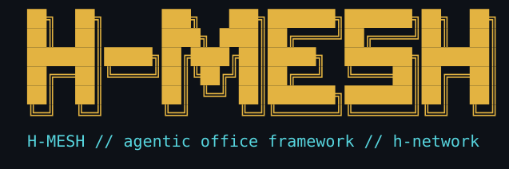

<p align="center">
  

  [](LICENSE)
  
  
  
  
</p>

# h-mesh

An agentic CLI framework where agents address each other directly, by name, and a single switch forwards every message to its destination. Work is tracked on a shared board per agent: pull a ticket, work it, mark it done.

Each agent is a real, stateful terminal session -- not a one-shot API call. It runs its own CLI (Claude, Codex, or Gemini/agy) in a live TUI, with conversation history that persists and resumes across restarts. One deliberate exception: a `claude_sdk`-type agent is the reverse of this by design -- a stateless one-off SDK call per message, with optional context-addressed memory layered on top instead of a persistent pane (see [One-off SDK agents and memory](#one-off-sdk-agents-and-memory) below).

The design borrows its layering from networking, not just its name -- a bus layer that only knows envelopes and queues, a switch layer that forwards by address without reading payloads, and an edge layer where each agent's actual delivery -- a terminal, a mailbox, or another destination-specific target -- lives. Same separation of concerns Ethernet uses between physical transport, switching, and the endpoint.

Every endpoint is a module, and every module owns its own port -- the piece that assembles an outgoing envelope and disassembles an incoming one into that endpoint's specific action.

A Telegram interface is included, talking to the framework over the same REST API any external client would use -- a separate module, not a special case.

Every hop a message takes is logged, the same way a real packet's path can be traced -- nothing moves silently.

## Quick install

On a fresh host, one command clones h-mesh and hands off straight to
`setup.sh`:

```bash
curl -fsSL https://raw.githubusercontent.com/h-network/h-mesh/main/install.sh | sh
```

It clones into `~/.local/share/h-mesh` by default (`H_MESH_INSTALL_DIR` to
choose another location), or updates an existing checkout there if one
already exists. That's a hidden, machine-managed location on purpose --
`~/h-mesh` itself is reserved for agent working directories (see
`setup.sh`'s wizard), not the source checkout. Extra arguments pass straight through to `setup.sh` -- e.g. to skip
the wizard:

```bash
curl -fsSL https://raw.githubusercontent.com/h-network/h-mesh/main/install.sh \
  | sh -s -- --pod mypod --tenant mytenant --non-interactive
```

This is a companion to cloning it yourself, not a replacement -- see below
for the manual clone-then-`setup.sh` path, and [Host installation](#host-installation)
for installing just the Python package without any of the bootstrap steps.

## Bootstrap script

Cloning it yourself first works exactly the same way, if you'd rather skip
the one-liner above:

```bash
git clone https://github.com/h-network/h-mesh.git
cd h-mesh
./setup.sh
```

`./setup.sh` bootstraps a fresh host or pod (already have a checkout? this
is what `install.sh` above hands off to). At a real terminal it first offers
container or host installation, defaulting to container; press Enter for
container or type `host` for the host path. `--host` skips that picker and
opens the interactive host wizard: pod/tenant name, how many agents and
their names (`architect` is agent #1 by default), which CLI each runs
(claude/codex/agy), account setup if more than one credential is needed,
optional vendor-model choice (a default and per-agent exceptions),
optional local model provider config (endpoint URL and model id, verified
with a real probe against the endpoint before it's accepted), and optional
Telegram bot config (bot token, chat ID, spoken voice replies). Re-running
it never silently wipes a prior answer -- blank at a prompt keeps whatever's
already there.

Piped, scripted, or passed `--non-interactive`, it defaults to host unless
`--container` or `H_MESH_INSTALL_MODE=container` selects container explicitly.
It never prompts -- flags,
environment, and whatever's already been configured for that tenant are all
it uses. Per-agent exceptions (`AGENT_CLIS`, `AGENT_MODELS`, `AGENT_PROFILES`,
`AGENT_PROVIDERS`) are each set as a comma-separated list of `agent=value`
pairs, e.g. `AGENT_CLIS=worker1=codex,worker2=agy` -- exactly one `=` per
pair, agent name on the left. A malformed entry (wrong separator, a missing
value) is a hard error, not a silently-ignored one: this matters most for
`AGENT_PROVIDERS`, since an agent with no override that setup.sh recognizes
runs against the real vendor API, not the local provider you configured for
it -- a typo there is real spend, not just a wrong setting. Either way it
also:

- verifies/auto-installs system dependencies (`redis-server`, `python3-venv`,
  and `h-agent` itself via its own installer) -- skip with `--skip-deps`
- installs h-mesh into a venv and persists that venv's `bin` dir on `PATH`
  (via `~/.bashrc` and `~/.profile`, so it's on `PATH` for every future
  shell/pane, not just the one running setup.sh)
- installs h-mesh's default `~/.tmux.conf` (mouse mode, status bar, pane
  borders -- the same UX the container base image otherwise bakes in, for a
  bare host that has none; never overwrites an existing `~/.tmux.conf`)
- installs a context-usage statusline (a progress bar showing how full the
  model's context window is) for the default account's claude config;
  profiled accounts get it too, at hire time, since that account's config
  dir doesn't exist until then. codex/agy agents are untouched -- they have
  their own statusline mechanisms, or none
- seeds the registry's fixed lifecycle participants (`host` -> office,
  `api` -> api) for the given pod/tenant
- starts the `h-mesh-switch`, `h-mesh-tmux-reconciler` and `h-mesh-watchdog`
  daemons (always-on -- watchdog needs no credentials, and every
  multi-agent office wants presence sampling and stall/silence alerting
  from the first hire on). Setup generates a random `API_TOKEN` once and
  starts the REST API even without Telegram, for example for inter-office cooperation. Configuring
  both `TELEGRAM_BOT_TOKEN` and `TELEGRAM_CHAT_ID` enables the REST API,
  Telegram bot, and session daemons too (the bot needs the
  API to talk to and session to back its `/watch` command; there's no
  separate "enable the API" question, a configured bot enables all three).
  The API alone starts neither Telegram nor session; existing bind/TLS
  validation still applies to the API.
  All duplicate-safe: a re-run against an already-running install restarts
  nothing that's already up, and a daemon disabled since a previous run
  gets stopped, not orphaned
- hires every agent from the wizard's roster that isn't already running

The always-on [inter-office reply relay](h-app/modules/interoffice/README.md)
stays idle until the lead records a remote office. It then reads that office's
reply stream with the cooperation token and admits replies locally as `relay`.
It checkpoints after admission; a crash before checkpoint can duplicate a reply.

```bash
./setup.sh                          # interactive picker, container by default
./setup.sh --host                   # interactive host wizard
./setup.sh --pod mypod --tenant mytenant --non-interactive   # scripted, no prompts
```

Run `./setup.sh --help` for the full set of flags (Redis URL, tmux session
name and socket, an existing venv, `--skip-install`, `--skip-deps`,
`--no-daemons`, `--non-interactive`, etc.). Daemon logs and PID files are
written under `$H_MESH_RUN_DIR` (default `~/.h-mesh/run/<tenant>`).

A host that never used the wizard (flags only, no roster ever configured)
keeps today's manual-hire behavior:

```bash
export AGENT_NAME=host POD=mypod TENANT=mytenant
h-mesh-office hire <agent-name>
```

Hiring starts a fresh CLI session by default, even when that agent name has
local session history. Pass `--resume` to opt into restoring prior history.
To delete a retired agent's saved history for good, use
`h-mesh-office purge <agent> --cli <claude|codex|agy> [--profile <account>] --confirm <agent>`
(refused while the agent is still enrolled; see `h-app/modules/office/README.md`).

From an operator shell outside the office, use `h-mesh-office run scratch` or
`h-mesh-office run monitor -- top`. These open non-addressable tmux windows,
separate from agents: messages are never pasted into them. Commands run once
and retain their exited output; close the window manually when finished.
See [raw process windows](h-app/modules/office/README.md) for working-directory
selection and lifecycle details.

### Optional vendor models

The host wizard accepts a free-text default model and per-agent model
exceptions. Hints depend on the chosen CLI; they are examples, not a list of
allowed IDs. Leave the model unconfigured to keep each CLI's own default.
On a rerun, blank keeps a saved choice; changing the default preserves agents
whose model differed from the previous default.

The same settings work without prompts:

```bash
AGENTS=architect,worker DEFAULT_MODEL=sonnet AGENT_MODELS=worker=opus \
  ./setup.sh --host --non-interactive
```

`DEFAULT_MODEL` and `AGENT_MODELS` are saved with the tenant configuration.
Model IDs retain their spelling and may not contain whitespace or commas.
They are not probed: an unavailable or incompatible vendor ID is reported by
the CLI at launch. Claude and agy receive `--model <id>`; Codex receives a
quoted `-c model="<id>"` override, including when resuming. Local-provider
agents use `PROVIDER_<NAME>_MODEL` instead and receive no vendor-model flag.
Settings are loaded when the reconciler starts and apply to subsequent
launches; changing them does not switch an already-running CLI session.
Restart the office daemons to reload settings after changing them on a rerun.

## Container

`container/Dockerfile`, `container/compose.yaml`, and the optional
`container/compose.ports.yaml` overlay are the supported way to
run h-mesh entirely in Docker -- one container per office (pod/tenant),
nothing assumed to exist outside the image. The container's `entrypoint.sh`
starts Redis (loopback-only, AOF-persisted under a state volume) and then
calls this same `setup.sh --non-interactive` -- the roster, hire, and
daemon-start steps are exactly the ones described above, not a separate
implementation.

```bash
./setup.sh --container                          # interactive wizard, at a terminal
./setup.sh --container --non-interactive         # scripted, flags/env only (or H_MESH_INSTALL_MODE=container ./setup.sh)
```

At a real terminal with no `--host`/`--container` flag, `./setup.sh` asks
which you want before anything else, with container as the default -- see
"Bootstrap script" above. Selecting container or passing `--container`
hands off entirely to `container/bootstrap.sh`, a smaller wizard (same
banner as the host wizard) that collects `POD`/`TENANT`/`AGENTS`/
`DEFAULT_CLI`, whether to publish the API/session ports (and which host
ports to use), one or more Claude account names, and each account's OAuth
token (blank to log in
interactively later -- see "Finding and attaching..." below for how a
container operator can actually do that), and optional Telegram bot config,
writes them to `offices/<pod>/<tenant>/.env` (alongside a regenerated
`SUMMARY.md` and executable `attach.sh`, neither of which contains secret
values), and runs `docker compose up
--build`. The interactive wizard always requires a TLS-or-plaintext choice
for the API, including when Telegram is declined. A certificate path requires
its key; plaintext requires an explicit yes, so completing the guided install
with published ports leaves the API reachable. Run `./container/bootstrap.sh
--help` for its full flag/env surface.

**One office, one directory, one explicit Compose project.** Docker
Compose's own project-name default is the *containing folder's* name
(`container`), identical for every checkout of this repo regardless of
pod/tenant -- two offices sharing a host, or even two checkouts of the same
repo, collide on that default, and one `docker compose up` silently
recreates the other's live office (measured, not theorized). `bootstrap.sh`
always resolves an office to `offices/<pod>/<tenant>/.env` and always passes
`docker compose -p h-mesh-<pod>-<tenant>` explicitly, so multiple offices
are isolated by construction. `offices/` is gitignored -- it holds live
credentials (`CLAUDE_OAUTH_TOKEN_<PROFILE>`, `API_TOKEN`, etc.), the same as
`container/.env` (kept as a single-office convenience default) always was.
Port publishing defaults to yes, with `API_PORT=8080` and
`SESSION_PORT=8081`, preserving the previous single-office behavior. The
wizard warns if a selected port appears in a sibling office's `.env` or is
already listening locally; choose distinct ports for multiple offices, or
decline publishing when an office only needs in-container access. Scripted
callers can use `--bind-ports`/`--no-bind-ports`, `--api-port`, and
`--session-port` (or `H_MESH_BIND_PORTS`, `API_PORT`, and `SESSION_PORT`).
An older office without `H_MESH_BIND_PORTS` is treated as bound for backward
compatibility.

For direct/manual Compose use, `compose.yaml` intentionally publishes no
ports on its own. Add the overlay when host access is wanted:

```bash
docker compose -p h-mesh-POD-TENANT \
  -f container/compose.yaml -f container/compose.ports.yaml \
  --env-file offices/POD/TENANT/.env up -d --build
```

**Finding and attaching a running office's tmux session.** Every bootstrap
run writes an executable `offices/<pod>/<tenant>/attach.sh` (using absolute
paths so it works from any directory) and a regenerated
`offices/<pod>/<tenant>/SUMMARY.md` (recording the deployed pod, tenant,
agents, default CLI, account names, published ports, Telegram on/off and TLS
vs plaintext mode, Compose project name, and the exact commands to attach,
stop, start, tail logs, and upgrade -- with no OAuth tokens, bot tokens, or
chat IDs written to either file). You can also run `./container/bootstrap.sh
--pod POD --tenant TENANT --attach` (defaults match the rest of
this script: `default`/`default`) to attach directly in one step --
resolves the same office identity `bootstrap.sh` always does, then runs
`docker compose exec` into the container and `tmux attach`s there. Every
`up`/`--attach` run also prints the exact one-liner for the office it just
resolved (including the equivalent plain `docker compose ... exec ... tmux
attach ...` form, if you'd rather not depend on this script). The tmux
session name is always the tenant name (`$TENANT`), inside the container's
own `$HOME/.h-mesh/tmux` socket directory -- not the host's tmux, and not
guessable from a bare `tmux attach` run outside the container.

Every non-interactive env var from "Bootstrap script" above (`AGENTS`,
`DEFAULT_CLI`, `ACCOUNTS`, `AGENT_CLIS`/`AGENT_PROFILES`/`AGENT_PROVIDERS`,
`CLAUDE_OAUTH_TOKEN_<PROFILE>`, `PROVIDER_LOCAL_*`, `TELEGRAM_*`,
`API_TOKEN`, `H_MESH_BIND_PORTS`, `API_PORT`, and `SESSION_PORT`) applies
unchanged. `bootstrap.sh`'s interactive wizard prompts
for the account count and names, each account's corresponding
`CLAUDE_OAUTH_TOKEN_<PROFILE>`, and for
`TELEGRAM_*` directly, mirroring the host wizard -- these were previously,
incorrectly, treated as file-only "advanced" options; a working office
always needs some credential, and the choice to enable Telegram is one the
host wizard already offered. Per-agent account assignment and other
exceptions (`AGENT_CLIS`/`AGENT_PROFILES`/`AGENT_PROVIDERS`) and local model
provider config (`PROVIDER_LOCAL_*`) remain file-only. `API_TOKEN` is never
prompted anywhere. Both host setup and container bootstrap generate 32 random
bytes (64 hex characters) when no token is configured, including without
Telegram. Container bootstrap persists it in `offices/<pod>/<tenant>/.env`
**before** starting Compose; reruns preserve the existing office token even
if a different `API_TOKEN` is ambient. A supplied `API_TOKEN` seeds a fresh
container office. Host setup keeps its existing explicit-env-over-persisted
precedence and stores the resolved token in `~/.h-mesh/<tenant>/env` (or
`$H_MESH_STATE_DIR/<tenant>/env`). Neither path regenerates an existing token
on an ordinary rerun. Both secret files are created/restricted to mode `0600`
before secrets are written; token values never appear in bootstrap output,
`SUMMARY.md`, or `attach.sh`. `H_MESH_BIND_PORTS=1` selects the ports overlay, while
`API_PORT`/`SESSION_PORT` choose the **host** side of that mapping only; the
api and session doors use fixed internal ports
`8080`/`8081` inside the container (`compose.yaml` and
`entrypoint.sh` pin the internal `API_PORT=8080` and `SESSION_PORT=8081` so
custom host ports in `.env` never move the container's internal listen ports
away from `compose.ports.yaml`'s `:8080`/`:8081` targets; see the Dockerfile's
own comment on why), so publishing them is compose's decision, not the
process's.

Each bootstrap starts `api` and the idle `interoffice_relay` without Telegram.
Setting `TELEGRAM_BOT_TOKEN` and `TELEGRAM_CHAT_ID` together additionally starts
`telegram_bot` and `session`. With `API_TLS_CERT`/`API_TLS_KEY` or explicit
`H_MESH_ALLOW_PLAINTEXT=1`, the container API listens on `0.0.0.0:8080` and
can be reached through its published host port. Container bootstrap takes
**host** `API_TLS_CERT`/`API_TLS_KEY` paths (and optional
`SESSION_TLS_CERT`/`SESSION_TLS_KEY` and `H_MESH_CA_CERT` host paths). It requires
OpenSSL, validates readable regular PEM files and matching unencrypted keys
before Compose starts, and copies them to `offices/<pod>/<tenant>/tls/`.
That directory is mode 0700, the copies are 0600, and
`compose.tls.yaml` mounts it **read-only** at `/run/h-mesh/tls`.
The private copies belong to container UID 1000: run bootstrap as host UID
1000 or root (root chowns only these copies/directory); other UIDs fail before
Compose starts with a permission message. Original host files are untouched.
Certificates are supplied by the operator, never generated by bootstrap.

```bash
API_TLS_CERT=/host/certs/office.crt API_TLS_KEY=/host/certs/office.key \
H_MESH_CA_CERT=/host/certs/peer-ca.crt \
  ./container/bootstrap.sh --pod mypod --tenant mytenant --non-interactive
```

The guided wizard asks for these host paths and an optional peer CA. The
generated `.env` contains the fixed **container** paths and `H_MESH_TLS_DIR`;
its summary/start/upgrade commands include the TLS overlay. On a clean-shell
rerun bootstrap reuses its staged files without rotating keys or changing their
contents. Supply new host paths explicitly to replace material. Host setup
and upgrades preserve the server TLS settings and `H_MESH_CA_CERT` in the
private tenant config, so restarted daemons and newly created agent panes
inherit the same trust. Existing panes retain their original environment.
The office directory, including keys and tokens, is excluded from Docker's
build context. Keep it private and retain it alongside the state volumes.

Relay and office CLI use the same verifying TLS context: an office record's
`ca_cert` wins over `H_MESH_CA_CERT`, then system trust. A supplied bundle is
the only trusted CA store for that connection. A per-office path must resolve
inside the relay container (the staged bundle is `/run/h-mesh/tls/ca.crt`).
Certificate and hostname verification are always enabled.

A **non-interactive** bootstrap with neither TLS nor plaintext opt-in still
starts the office and API. The entrypoint restricts the API (and an enabled
session door without TLS) to **container loopback**. The published API port
then remains closed from the host. The last bootstrap output line and the
office's `SUMMARY.md` explain how to open it: rerun bootstrap with
`API_TLS_CERT` and `API_TLS_KEY`, or explicitly accept plaintext, for example:

```bash
H_MESH_ALLOW_PLAINTEXT=1 ./container/bootstrap.sh --pod mypod --tenant mytenant --non-interactive
```

The app-level refusal of plaintext on non-loopback binds remains in force.
On bare hosts the API defaults to loopback; configuring a non-loopback host
bind still requires TLS or the same explicit plaintext opt-in. Session starts
only with complete Telegram settings, and otherwise stays off.

Three named volumes per office carry state that must survive a container
recreate: Redis's AOF file, the persisted tenant config, and daemon
logs/pidfiles (`$HOME/.h-mesh`); and claude's and codex's own local state,
notably `--continue`/`--resume` session history (`$HOME/.claude`,
`$HOME/.codex`) -- without the latter two, that history lived only in the
old container's writable layer and was gone the moment `up` replaced it.
`docker compose down` keeps all three, `down -v` drops them. `docker compose
logs -f` shows the same daemon logs `$H_MESH_RUN_DIR` would on a bare host,
tailed by the entrypoint. `h-agent`, its CLIs, and h-mesh's own package are
all installed at image build time (`h-agent`'s own installer, the same one
setup.sh's dependency step would otherwise run on a bare VM missing it, plus
`jq` so it can actually apply its own onboarding defaults -- without it,
every agent's first launch hits claude's full interactive first-run tour
instead of a working prompt) so a running container never needs outbound
network just to boot.

`clients/web` (the browser console) is not part of this image -- it has its
own separate container path; see `clients/web/README.md`.

## One-off SDK agents and memory

Not every agent needs a persistent terminal session. A `claude_sdk`-type
agent (see `modules/claude_sdk/README.md`) runs one Claude Agent SDK
`query()` call per message instead of hosting a live CLI pane -- no
`ClaudeSDKClient`, no persistent session, the opener sends the reply itself.
There's no `office hire` path for one yet; it's registered directly in the
tenant registry.

A `Message` payload's `context` field names a hot-tier, TTL-evicted
conversation (`lib/chat_memory.py`) -- the same `context` on a later
message recalls that conversation's recent turns; omitting `context`
entirely is a genuine one-off, no memory read or write at all:

```bash
h-mesh-office send -a AGENT --context bgp-65001 "..."   # threads into that context
h-mesh-office send -a AGENT "..."                        # genuine one-off, no memory touched
h-mesh-office contexts -a AGENT                          # list AGENT's live contexts
```

The same discovery is reachable externally at `GET /agents/{agent}/contexts`
(see `modules/api/README.md`). Long-term/semantic memory -- what, if
anything, happens once a context's TTL elapses -- is deliberately out of
scope today; see `lib/chat_memory.py`'s own module docstring.

## Upgrading and restarting daemons

`h-mesh-upgrade` (`services.upgrade`) updates an existing install in place --
`git pull --ff-only`, reinstall, then execute a fresh interpreter of the
updated tree to prepare configuration and cleanly restart the daemons
setup.sh started (stop via SIGTERM/SIGKILL fallback, then start fresh with
the current environment). It won't double-start daemons against an
already-running install: it always stops first.

```bash
h-mesh-upgrade --pod mypod --tenant mytenant
```

The fresh phase preserves an existing `API_TOKEN` even if a different one is
ambient, or generates and persists one in the tenant's mode-`0600` config
before starting API. It preserves the other stored settings. The reply relay
always runs; API runs with the token; Telegram/session still require both
Telegram settings. Without complete TLS settings or `H_MESH_ALLOW_PLAINTEXT=1`,
API uses loopback and prints the exact settings needed for non-loopback
access. Repeating upgrade restarts one daemon set and keeps the token and
office state; already-hired host panes are preserved.

**First transition from a pre-fix upgrader:** run the ordinary command above,
then run this once from a fresh shell/process with the same identity and any
explicit Redis/venv/tmux flags:

```bash
h-mesh-upgrade --pod mypod --tenant mytenant --skip-pull --skip-install
```

The first old interpreter keeps its imported daemon roster after updating
files; the second invocation loads the new fresh-interpreter handoff and
establishes the token/API/relay configuration. A third invocation is safe:
the token and state stay unchanged while daemons are cleanly restarted.
New upgraders perform the fresh handoff themselves and need only one call.
The [migration proof](docs/upgrade-token-proof.md) records the old/second/third
sequence and the isolated container transition with exact commands.

**Container offices:** upgrade from the host by updating the checkout, then
rerunning bootstrap for the **same pod and tenant**, using its existing
generated `.env` and named volumes:

```bash
git pull --ff-only
./container/bootstrap.sh --pod mypod --tenant mytenant --non-interactive
```

Do not hand-edit `.env` or run `down -v` during this transition. Bootstrap
creates a missing token, preserves an established one, rebuilds/recreates
the container, and setup starts the current API/relay daemon set. Boards,
inboxes and registry live in the retained state volume. Container panes are
recreated from that registry; this does not preserve running pane processes.
On a pre-fix office without transport settings, the upgrade succeeds with
container-loopback API and the last output line plus `SUMMARY.md` explain
why the published port stays closed. To open it, configure existing
host TLS paths through `API_TLS_CERT`/`API_TLS_KEY`, or explicitly
accept plaintext on the bootstrap rerun:

```bash
H_MESH_ALLOW_PLAINTEXT=1 ./container/bootstrap.sh --pod mypod --tenant mytenant --non-interactive
```

The two-command legacy `h-mesh-upgrade` sequence above applies to host
installs. Container offices use this host-side bootstrap rerun instead of
pulling Git from inside the image. If an image was already built from the
exact checkout SHA, `H_MESH_IMAGE=<that-tag>` with `--skip-build` reuses it.

Same pod/tenant/redis-url/session/tmux-tmpdir/tmux-socket/venv flags as
setup.sh, plus `--skip-install` and `--skip-pull` (`h-mesh-upgrade --help`
for the full list). Pod and tenant must be valid non-empty h-mesh names; an
invalid value is rejected before the upgrade stops or starts anything. It
also re-persists the venv bin dir on `PATH`,
re-installs the default `tmux.conf`, and re-installs the default account's
statusline, so running it repairs an install that predates any of those
fixes.

⚠ **Known limit:** a hired agent's tmux pane inherits its environment once,
at creation. Upgrading restarts h-mesh's own daemons and reinstalls the code
they run, but it cannot reach into an already-hired agent's live pane and
refresh its env -- that agent keeps whatever it started with until it's
re-hired or its window is otherwise recreated. This is deliberate: forcing
that refresh would mean killing live agent sessions on every upgrade.

`h-mesh-start` (`services.daemons`) starts the same daemons without pulling
or reinstalling -- useful after a crash, or on a host where they aren't
running yet. It's also duplicate-safe: a daemon it finds already alive (via
its authenticated pidfile) is left running rather than started a second time.
Pidfiles are paired with the Linux process start time, and daemon management
opens a Linux pidfd before authentication then signals through that same process
handle, so a reused numeric PID cannot redirect a signal to an unrelated
process. If ownership cannot be
proved, daemon management fails closed and reports the condition without
signalling; a stale PID that demonstrably belongs to another process is treated
as the normal “daemon not running” state. A start is
atomic with respect to processes that invocation creates: they are reported
as started only after surviving the startup health window, and if any one
fails, all newly created siblings are stopped. Processes found running before
the invocation are never part of that rollback.

```bash
h-mesh-start --pod mypod --tenant mytenant
```

## Host installation

h-mesh is installed from the repository root. An editable install is useful for
development; a regular install uses the same package metadata for production:

```bash
python -m venv .venv
.venv/bin/python -m pip install -e .
```

Contributors running the test suite should install the test extra with
`.venv/bin/python -m pip install -e '.[test]'`.

After activating the project virtual environment, run the complete suite with
the canonical runner. The runner resolves the repository root itself, so the
command works from any working directory:

```bash
python -m tools.run_tests
```

The configured test path covers the entire `h-app` source tree, including
tests colocated under `clients/web`. The runner asserts a minimum collection
count before executing pytest, so under-collection fails loudly while normal
test additions require no maintenance. If tests are intentionally removed,
update `EXPECTED_MINIMUM_TEST_COUNT` in the runner.
Passing an explicit path such as `pytest tests/` overrides configured discovery
and intentionally runs only the selected subtree; do not use a narrowed path
as evidence that the complete suite passes.

Use an isolated environment when developing or validating an install. In
particular, do not install h-mesh into an environment that provides another
application's live commands; keeping prefixes separate prevents either
application from replacing the other's executables.

The install makes the top-level `core`, `lib`, `modules`, and `services`
packages importable independently of the current working directory. It also
provides these process entry points:

- `h-mesh-switch` — the core switch daemon
- `h-mesh-api` — the REST API daemon
- `h-mesh-openshell-port AGENT` — direct OpenShell delivery-port invocation
- `h-mesh-session` — the tmux control-mode session daemon
- `h-mesh-tmux-reconciler` — the tmux registry reconciler daemon
- `h-mesh-watchdog` — the delivery and presence watchdog daemon
- `h-mesh-tmux-port AGENT` — direct tmux delivery-port invocation
- `h-mesh-office` — the operator CLI
- `h-mesh-clone-to-all` — the standalone clone-to-all compatibility command
- `h-mesh-upgrade` — pull, reinstall, and cleanly restart the daemons setup.sh started
- `h-mesh-start` — start those same daemons if not already running, without pulling or reinstalling

The `h-mesh-` prefix is intentional: h-mesh can share an installation prefix
with another application without replacing its live `office` executable.

Each process reads its deployment configuration from environment variables;
the module READMEs document the required variables and external services.

## License

PolyForm Noncommercial 1.0.0 -- see [`LICENSE`](LICENSE). Third-party
dependency licenses are credited in [`NOTICE`](NOTICE). "h-mesh" and
"h-network" naming/branding are covered by [`TRADEMARKS.md`](TRADEMARKS.md).
